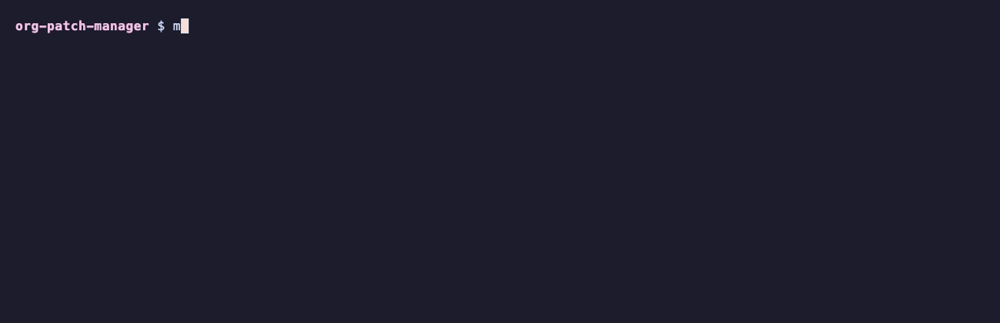

<div align="center">


# org-patch-manager

**Patches EC2 instances in every AWS account, including accounts that join later. A tag decides which ones may reboot.**

[](versions.tf)
[](cloudformation)
[](tests)
[](LICENSE)

<br>



<sub>The tests and a tagging dry run, with <code>make demo</code>. Runs against a mocked provider and a fake AWS CLI, so no AWS account is needed.</sub>

</div>

## ✨ What it does

- **Covers every account** in an OU or the whole organization. New accounts are enrolled when they join.
- **Scans every managed instance daily.** The scan is read-only and never reboots.
- **Installs patches nightly**, only on instances with the tag:

| `patch-reboot` tag | Scanned daily | Patched nightly | Reboots |
|---|:-:|:-:|---|
| `if-needed` | yes | yes | when an update needs it |
| `never` | yes | yes | never; kernel updates wait for an operator-chosen reboot |
| *(no tag)* | yes | no | no |

Part of [aws-security-toolkit](https://github.com/simar-s2/aws-security-toolkit), and works on its own.

<a name="run-it"></a>
## ⚡️ Run it

Your instances need to be managed by Systems Manager, which [ssm-access](https://github.com/simar-s2/ssm-access) sets up. From the management account (`r-ab12` is your organization's root ID; an OU ID works too):

```bash
git clone https://github.com/simar-s2/org-patch-manager && cd org-patch-manager
# Once per organization
aws cloudformation activate-organizations-access --profile management
scripts/deploy.sh --profile management --regions us-east-1,us-west-2 \
  --targets r-ab12 --log-archive-profile log-archive
```

Then tag the instances that are already running, once per account:

```bash
# See what it would tag
scripts/default-reboot-tag.sh --profile my-account --regions us-east-1,us-west-2 --dry-run
# Tag them
scripts/default-reboot-tag.sh --profile my-account --regions us-east-1,us-west-2
```

This tags untagged instances `if-needed`, **so they may reboot**. First tag any host that must not reboot on its own with `patch-reboot=never`.

Terraform and every option: [docs/SETUP.md](docs/SETUP.md).

## 🔬 How it works

A StackSet deploys one template to every account under the OUs you pick, in each region you list. Each account gets default patch rules for Amazon Linux 2023 and Ubuntu, a daily scan and a nightly install. Results show up in Security Hub, and can also be copied to one central bucket.

The architecture diagram and the choices I made: [docs/DESIGN.md](docs/DESIGN.md).

## 💰 Cost

Patch Manager has no extra charge for EC2 instances. You pay for a little S3 storage and the usual data transfer when instances download updates. Security Hub [bills separately](https://github.com/simar-s2/org-security-baseline#cost) for its checks.

## 💡 Things I learned

- **A new State Manager association runs right away.** Without `ApplyOnlyAtCronInterval`, deploying the StackSet would patch and reboot every tagged instance on the spot.
- **One broken host can stop everyone's patches.** With a low `MaxErrors`, a host that can never install stops the run, and every host after it in that account is skipped every night. So the limit is 100%.
- **Don't patch EKS nodes in place.** The EKS-optimized AMI pins the kernel and container runtime, so installs fail. Replace the nodes instead.

## 🛠️ Development

```bash
make test    # pytest and terraform test; nothing calls AWS
make lint    # terraform fmt/validate, tflint, cfn-lint, checkov, shellcheck
make demo    # the recording above
```

## 📄 License

[MIT](LICENSE)
