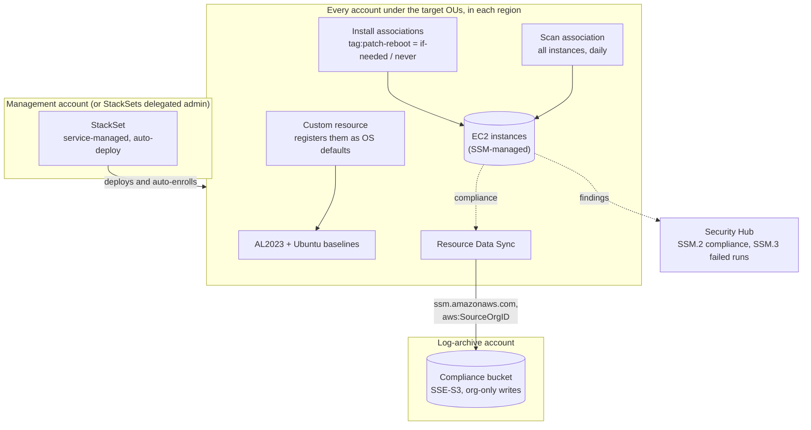

# Design notes

How org-patch-manager rolls out to every account, the choices I made, and what it costs.

## Architecture



## What it does, in detail

A service-managed CloudFormation StackSet deploys one template into every account under the target OUs (or the organization root), in each region you choose. In every account it:

- **Creates two patch baselines and makes them the OS defaults.** Amazon Linux 2023 gets security and bugfix updates after a 7-day soak; Ubuntu gets required, important and standard updates. Because they are the defaults, they apply to every instance of that OS with no Patch Group tags to maintain. Other operating systems keep using the AWS default baseline.
- **Scans every managed instance daily.** A read-only scan that never reboots, so compliance is always current and shows up in Security Hub as control SSM.2.
- **Installs nightly on instances that opted in with a tag.** The `patch-reboot` tag decides whether an instance may reboot after patching. Untagged instances are scanned but never patched automatically.
- **Exports patch compliance to one central bucket** (optional). Each account's SSM Resource Data Sync writes to an S3 bucket in the log-archive account, so the whole fleet can be queried in one place.

New accounts are enrolled automatically when they join a target OU, and the stacks are removed when they leave.

| `patch-reboot` tag | Scanned daily | Patched nightly | Reboots |
|---|:-:|:-:|---|
| `if-needed` | yes | yes | when an update needs it |
| `never` | yes | yes | never; kernel updates wait for an operator-chosen reboot |
| *(no tag)* | yes | no | no |

**Tech:** Terraform (AWS provider 6), CloudFormation StackSets, AWS Systems Manager (Patch Manager, State Manager, Resource Data Sync), a Python custom resource, Bash, pytest, GitHub Actions.

## Why it's built this way

- **Default baselines instead of Patch Groups.** Registering the baselines as the OS defaults covers every instance with no tagging. CloudFormation has no resource for that, so a small custom resource calls `RegisterDefaultPatchBaseline`. On delete it reverts to the AWS baseline only if ours is still the default, so replacing a baseline during an update doesn't leave the account on the AWS default.
- **Scan everything, install only what opted in.** A host nobody has looked at yet should never be rebooted by a patch run. Untagged instances are visible as non-compliant, which prompts someone to classify them.
- **Two install associations.** State Manager targets are include-only (there's no "exclude"), so the no-reboot carve-out needs its own association.
- **`ApplyOnlyAtCronInterval` on the install associations.** Without it, State Manager runs a new association right away, which would patch and reboot every tagged instance the moment the StackSet deploys.
- **`MaxErrors` of 100%.** With a low limit, one host that can never install (for example an image with pinned packages) stops the run, and every host after it in that account is skipped every night.
- **Nightly installs.** The daily scan finds missing patches within a day; a weekly install window would leave approved patches unapplied for up to six more days.
- **EKS nodes are replaced, not patched.** The EKS-optimized AMI pins the kernel and container runtime, so in-place installs fail. Update the node group AMI (or let Karpenter drift) instead; the tagging script skips these nodes.
- **`never` for hosts with custom drivers.** GPU hosts and appliances with kernel modules (for example DKMS drivers) need the module rebuilt for a new kernel, so the reboot should happen when an operator can check it.
- **Short-lived hosts are exempt.** A build agent that lives a few hours never completes a patch-and-reboot cycle; keep its base image current and tag it `ssm-exempt=true`.
- **No soak period for Ubuntu.** APT repositories don't provide reliable release dates, so Ubuntu updates are approved immediately.
- **SSE-S3 on the compliance bucket.** Many cross-account writers and low-sensitivity data: a KMS key would need grants for every account's SSM service without adding real protection.
- **Watch SSM.3, not just SSM.2.** A failed patch run shows up in Security Hub as SSM.3, which is LOW severity and easy to miss in a CRITICAL/HIGH view. [security-digest](https://github.com/simar-s2/security-digest) rolls SSM.2 and SSM.3 up per account in its daily Slack message.

## Cost

Patch Manager, State Manager and Resource Data Sync have no extra charge for EC2 instances. What you pay for:

- **S3** storage for the compliance export: a few KB per instance per day, expired after 395 days.
- **Lambda**: the custom resource runs only when a stack is created, updated or deleted, well inside the free tier.
- **Data transfer**: instances download updates through a NAT gateway or VPC endpoints, which are billed as usual.
- **Security Hub** bills for the SSM.2 and SSM.3 control checks if you have it on (see [org-security-baseline](https://github.com/simar-s2/org-security-baseline#cost)).

## Project layout

```
main.tf, variables.tf, ...        root module: the StackSet (management account)
modules/compliance-bucket/        central compliance bucket (log-archive account)
cloudformation/patch-baseline.yaml  the member-account template, used by both deploy paths
cloudformation/compliance-bucket.yaml
scripts/deploy.sh                 one-command CloudFormation deploy
scripts/default-reboot-tag.sh     tag existing instances
examples/                         Terraform examples
tests/                            pytest (custom resource, scripts) and terraform test
```

## Testing

The custom resource tests load the function source directly from the CloudFormation template, so they test exactly what gets deployed.
